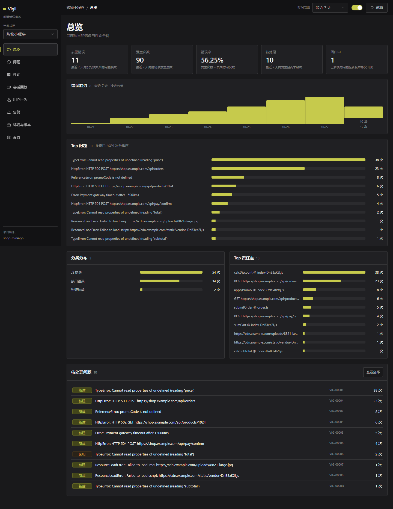

# Vigil · 前端可观测性平台

多应用可接入的前端监控：**浏览器 SDK + 采集服务 + 管理面板**。

不只是"错误日志"—— 错误、性能、行为、回放在**同一个会话**上打通，
能回答"这个错误是不是拖慢了这页"和"用户当时在干什么"。

---

## 它解决什么

| 能力 | 说明 |
|---|---|
| **Issue 生命周期** | 错误不是一条记录，是**一个工单**：有状态、负责人、评论、活动历史 |
| **Resolve with Release** | 在 `1.4.3` 上解决的问题，只有 `1.4.4+` 出现才算**回归** |
| **会话回放** | 出错那一刻的页面现场，rrweb 逐事件回放，可拖动定位 |
| **用户行为** | 访问、路径、点击分布 —— **不记录任何输入内容** |
| **性能 RUM** | Web Vitals（LCP/CLS/INP/TTFB）、长任务/TBT、接口 span、路由事务 |
| **错误与性能关联** | 报错事件带上**当刻的 LCP/FCP/长任务数** |
| **告警引擎** | 6 类规则 × 5 种通道，带去重静默（避免告警疲劳） |
| **多租户** | 组织 → 团队 → 项目 → 环境 / 版本，三层隔离 |
| **安全** | 双密钥分离、采集端脱敏、sourcemap 不出服务端 |

---

## 架构

```
┌──────────────┐  /collect（错误·全量）    ┌──────────────────────┐
│              │ ─────────────────────────▶ │                      │
│   浏览器页面  │  /performance（性能·采样）  │   Vigil Collector    │
│  @vigil/sdk  │ ─────────────────────────▶ │  Fastify + SQLite    │
│              │  /behavior（行为+回放）      │  模块化单体           │
└──────────────┘ ─────────────────────────▶ └──────────┬───────────┘
         │                                                 │
         │  /sourcemaps（仅 CI，不在浏览器里）              │
         └────────────────────────────────────────────────▶│
                                                        │
                              ┌─────────────────────────┼──────────────────────┐
                              ▼                         ▼                      ▼
                      ┌───────────────┐         ┌──────────────┐      ┌─────────────┐
                      │  问题域        │         │  性能域       │      │  告警域      │
                      │  Issue 状态机  │         │  事务/span    │      │  规则/通道   │
                      │  活动流/回归   │         │  分位数聚合    │      │  评估/去重   │
                      └───────────────┘         └──────────────┘      └─────────────┘
                              │                         │                      │
                              └─────────────────────────┴──────────────────────┘
                                                        │
                                    ┌───────────────────┴──────────────────┐
                                    ▼                                      ▼
                            ┌───────────────┐                      ┌──────────────┐
                            │  回放域        │                      │  行为域       │
                            │  会话/事件流   │                      │  访问/路径/点击│
                            └───────────────┘                      └──────────────┘
                                                        │
                                              ┌──────────────────────┐
                                              │   Vigil Dashboard     │
                                              │  Vue3 + Element Plus  │
                                              └──────────────────────┘
```

**四个包 + 一个独立入口**：

| 包 | 作用 | 依赖 |
|---|---|---|
| `@vigil/protocol` | 上报协议的类型契约（纯类型，零运行时） | 无 |
| `@vigil/sdk` | 浏览器采集 SDK（ESM + IIFE 两个产物） | 无框架依赖 |
| `@vigil/sdk/replay` | 会话回放 + 用户行为（**独立入口**） | rrweb |
| `@vigil/collector` | 采集服务 + 管理 API | Fastify、better-sqlite3 |
| `@vigil/dashboard` | 管理面板 | Vue 3、Element Plus、vue-router、rrweb-player |

---

## 快速开始

```bash
npm install
npm run demo
# → 面板  http://localhost:5174
# → 接口  http://localhost:4318
```

分开起：

```bash
npm run dev:collector       # 采集服务，:4318
npm run dev:dashboard       # 管理面板，:5174
npm run seed:demo -- --reset # 重置演示数据
```

建组织 / 项目 / 环境 / 版本：

```bash
npm --prefix packages/collector run cli -- org create "我的组织"
npm --prefix packages/collector run cli -- project create 1 "我的应用"
npm --prefix packages/collector run cli -- env add 1 production "生产环境" --production
npm --prefix packages/collector run cli -- release add 1 1.4.2
```

---

## 接入 SDK

```html
<head>
  <!-- ⚠️ 放 <head> 同步加载：ESM 的 module script 是 defer 的，
       初始化会晚于首屏静态资源的加载失败（那样一条都收不到） -->
  <script src="https://cdn.example.com/vigil.iife.js"></script>
  <script>
    Vigil.init({
      endpoint: 'https://collector.example.com/api/v1/collect',
      appId: 'shop-miniapp',
      token: 'vsk_xxx',
      release: '1.4.2',
      environment: 'production',
      userId: 'u_123',
      performanceSampleRate: 0.1
    })
  </script>
</head>
```

bundler 项目走 ESM：

```ts
import { init } from '@vigil/sdk'
const vigil = init({ endpoint, appId, token, release })

// SPA 路由切换时上报一个路由事务
vigil.startRoute('/orders')
```

Vue 项目接组件错误：

```ts
import { installVueErrorHandler } from '@vigil/sdk/vue'
installVueErrorHandler(app, (err) => vigil.captureException(err))
```

要**会话回放**和**用户行为**时，额外引入独立入口：

```ts
import { init } from '@vigil/sdk'
import { replayPlugin, behaviorPlugin } from '@vigil/sdk/replay'

init({
  endpoint,
  appId,
  token,
  release,
  plugins: [replayPlugin(), behaviorPlugin()]
})
```

⚠️ 回放**独立成入口**是有意的：rrweb 压缩后 74KB gzip，
打进核心会让 SDK 膨胀 6 倍，而绝大多数用户不需要回放。

⚠️ 插件的 `setup()` 在初始化时同步执行 —— 想要**完整的首屏快照**，
就把 `init` 放到 `DOMContentLoaded` 之后（rrweb 的第一帧是全量快照，
启动太早只能拍到空壳）。

详见 [`docs/integration.md`](docs/integration.md)。

---

## Issue 生命周期

这是本项目和"错误日志"最大的区别。

```
                        ┌──────────────────────────┐
                        │                          │
   [新事件] ──▶ unresolved(new)                 │
                        │                          │
                  7 天无新事件 / 人工已阅           │
                        ▼                          │
                 unresolved(ongoing)              │
                        │                          │
        ┌───────────────┼───────────────┐          │
        ▼               ▼               ▼          │
   resolved        archived    (escalating) ────────┘
        │               │
        │          事件量超基线
        │               ▼
        │          escalating ──▶ unresolved(ongoing)
        │
   新事件且 release > 解决它的 release
        │
        ▼
   regressed ──(7 天)──▶ unresolved(ongoing)
```

**Resolve with Release** 是精华：在 `1.4.3` 标为已解决后，
`1.4.3` 及更早版本再报都算噪音，只有 `1.4.4+` 出现才算回归。
这直接回答"这个 bug 是不是我上次的修复引入的"。

每一次状态变化都写**活动流**，记录 actor（人 or SYSTEM）和原因 ——
系统改自己的主意时也留痕。

---

## 验证

**全部用数字验证，不看截图。**

```bash
npm run test              # 157 条单元测试（Collector 82 + SDK 75）
npm run verify            # 33 条端到端断言（真 Chromium → 真 HTTP → 真 SQLite）
npm run verify:dashboard  # 45 条面板渲染断言
npm run audit:ui          # 15 条界面设计闸门（见下）
npm run typecheck
npm run lint
```

### 界面设计闸门

`npm run audit:ui` 把「界面好不好看」拆成**可自动测的数字**：

| 闸门 | 判据 |
|---|---|
| 字阶对比 | 最大字号 ÷ 最小字号 ≥ 2.5×（没有层级就没有设计感） |
| 字号档位 | 6–14 档，且不连续堆叠 |
| 颜色收敛 | 单页 ≤ 24 种 |
| 动效档位 | ≥ 2 档时长（不能一个 `0.3s ease` 用到底） |
| 焦点环 | ≥ 90% 可聚焦元素有可见焦点环 |
| 点击目标 | 桌面主控件 ≥ 32px / 行内按钮 ≥ 24px / 触摸主控件 ≥ 40px |
| 横向溢出 | 320 / 375 / 414 / 768px 下都不能溢出 |
| 动效降级 | `prefers-reduced-motion` 下内容不消失、动效被压制 |

同时输出**静帧截图**到 `docs/screenshots/` —— 动效关掉之后长什么样，
那是「设计感」真正被看见的地方。

<details>
<summary>总览页静帧</summary>



</details>


`npm run verify` 跑的是**真实链路**，断言覆盖：

```
✓ 五类错误都落库了 — 去重后 5 条 / 累计 6 次
✓ 同一个错误报两次聚合成一条 — count=2
✓ 标记已解决 → 状态 resolved 且记录了版本 — resolvedInRelease=1.0.0
✓ 在更新版本重新出现 → 判为回归 — substatus=regressed
✓ 在同版本重新出现 → 保持 resolved（是噪音不是回归）
✓ 活动流记录状态变化 — created → resolved → regressed
✓ 压缩产物的栈被 sourcemap 还原 — app.min.js:1:20 → src/user-profile.ts:1
✓ URL 里的 token 被脱敏 — token=***
✓ 上报请求自身没被当成错误（无递归）— 0 条
✓ 性能事务入库且分位数可查 — LCP P95=2100ms
✓ 错误事件带上了性能快照 — 6 条事件带 vitals
✓ 告警规则能触发并落库 / 去重生效
✓ 页面卸载后事件仍能送达（beacon 通道）
✓ 回放事件流已入库 — 4 个事件（真浏览器录的 rrweb 流）
✓ 回放流里有全量快照（增量链的起点）— 快照位置 1 · 类型分布 4 / 2 / 3
✓ 全量快照排在增量之前 — 快照位置 1 · 首个增量位置 2
✓ 回放流保留了 Meta（视口尺寸）— 播放器靠它把内容按比例缩放
✓ 回放流能从管理 API 读回 — API 返回 4 个事件 · 库里 4 个
✓ 行为事件入库 — 类型分布 click / pageview
✓ 行为汇总 API 返回的访问次数与库一致
```

`npm run verify:dashboard` 自带播种（自建演示项目 + 注入 localStorage），
断言的是**渲染出来的 DOM 文本**：

```
✓ 侧边导航有 8 个导航项
✓ 「去重错误」卡片 = 接口的 stats.total
✓ 问题表格渲染 N 行 = 接口返回的行数
✓ 点击行后跳到 /issues/<id>，详情页出现活动流
✓ LCP P95 显示值 = 接口返回的 p95
✓ 会话表格渲染 N 行 = 接口返回的会话数
✓ 回放播放器挂载成功 — 1 个播放器
✓ 回放控制条有 3 个控件 / 回放显示时间读数
✓ 「访问次数」卡片 = 接口的 pageViews
✓ 控制台 0 报错
```

---

## 关键设计决策

### 指纹：用 category 不用 kind

`ErrorKind`（js/promise/vue/manual）只说明"谁抓到的"；
`ErrorCategory`（javascript/resource/http）才是分组维度。
Vue 捕获和全局捕获到同一个错误，必须是**同一条**。

### 指纹不含行号列号，也不含构建 hash

改一行代码不该让错误的"历史"断掉；每次发版也不该让所有错误都变成新的。

### 指纹要校验，缺失时服务端兜底

指纹是聚合主键。照单全收客户端的值，一个**空串**就能让该应用的所有错误
塌成一行 —— 表面上有数据，实际全是同一条错误。

### 聚合靠数据库 UNIQUE 约束

`UNIQUE (app_id, fingerprint)` + UPSERT。应用层"先查再插"在并发下必然出重复行。

### 限流按项目，不按 IP

上报请求来自**用户的浏览器**，IP 是用户的不是项目的。
按 IP 限流会误伤同一出口 IP 后的所有用户。

### 告警去重

同一个（规则, 问题, 时间窗）只发一次。告警疲劳是监控系统最大的敌人 ——
同一个错误每分钟报 100 次，没有人会去看。

### 三条上报通道

| | 错误 | 性能 | 行为 / 回放 |
|---|---|---|---|
| 端点 | `/api/v1/collect` | `/api/v1/performance` | `/api/v1/behavior` |
| 采样 | 全量 | 10% | 全量（可配） |
| 体积 | KB 级 | 每条几十 KB | 回放可达几百 KB |

性能数据量大且绝大多数正常，混在一起就没法"错误全量、性能采样"。

回放必须**单独走**：它随错误一起上报（挂在事件上），但体积是两个数量级的差别 ——
混进错误通道的话，错误事件的采样、保留、批量策略会被回放拖垮。

### 通道地址从 endpoint 推导，不拼字符串

`endpoint` 是错误通道的完整地址（`.../api/v1/collect`）。
性能和行为是它的**兄弟通道**，地址要**推导**（去掉最后一段）而不是拼接。

拼出来会得到 `.../api/v1/collect/api/v1/behavior` —— 404，而且**不报错**：
请求发出去了、服务端也收到了，只是路由不匹配。
面板上看到的是「行为数据一条都没有」，SDK 侧一切正常，日志里连一条警告都没有。

### 双密钥分离

| 密钥 | 用途 | 放在哪 |
|---|---|---|
| `vsk_` | 上报 | 前端代码里 |
| `vup_` | 上传 sourcemap | **只在 CI 里** |

数据库只存哈希，明文只在创建时返回一次。

### 脱敏在采集端

监控系统会原样收集用户页面上的东西。采集端不脱敏，
等于把用户隐私复制进了一份新的数据库。
敏感键按**词段**匹配：`userPassword` 命中，`monkey` / `statusCode` 不命中。

### 模块化单体，不是微服务

三个域紧耦合（告警要读问题状态，性能要关联错误上下文）。
拆成进程就要处理跨进程查询、事务边界、最终一致性 ——
复杂度换来的收益在这个量级用不上。域的边界已经是现成的切缝。

### 数据层可换库

本机 Docker 跑不起来（缺 WSL2），只能用 SQLite。
但 schema 用方言层生成，PG 也能跑，**领域代码一行不用改**。

### 回放是独立入口，不进核心

rrweb 压缩后 74KB gzip，打进 SDK 核心会让它膨胀 6 倍，
而**绝大多数用户根本不需要回放**（尤其涉及隐私合规的团队）。

所以回放是独立入口 `@vigil/sdk/replay`，核心完全不知道它的存在。
面板侧同理：播放器是**动态加载**的 chunk，只有真的打开回放时才拉。

### 增量链必须从全量快照开始

rrweb 的回放是「一个全量快照 + 一串增量」。中间丢掉任何一段，
后面的增量**全部对不上**，回放直接废掉。

所以客户端缓冲区满了**不能丢中间的**，只能重新取一次全量快照。
代价是丢失更早的历史，但保证回放**始终可播**。

这条不变量靠一个纯函数守住（`sdk/src/replay/buffer.ts`）——
策略一旦写错，回放会**静默播不出来**，不报任何错。

### 回放按会话存最新一份

客户端的缓冲区是滚动窗口：第 2 个错误带的上传窗口比第 1 个更长。
每个错误都存一份 = 大量重复数据。

所以**每个会话只保留最新的一份回放流**。代价是回放展示的是「最近一次快照」，
不精确对应每个错误的时间点 —— 这个限制写进了文档，不藏着。
好处是存储有界：一个会话一份流，不会随错误数线性膨胀。

### 回放比行为汇总先到是常态

错误是立即上报的，行为汇总要等攒批或页面卸载。
所以**回放到达时会话行可能还不存在** —— 只 UPDATE 的话这一行永远建不出来，
结果是「回放事件躺在库里，但会话列表里看不到它」。

采集端在写回放时**保证会话行存在**，不依赖行为先到。

### 行为不记录任何输入内容

只记「点了某个按钮」，不记「在搜索框里输入了 xxx」。
输入内容是最敏感的数据，而它对定位问题的价值最低 ——
知道用户点了「提交订单」已经够了。

这条边界是**设计出来的**，不是没实现：SDK 侧不采集输入值，
rrweb 侧 `maskAllInputs` 全开，文本还会做 PII 脱敏。

---

## 目录结构

```
packages/
  protocol/    上报协议类型契约（纯类型）
  sdk/         浏览器采集 SDK
    src/
      collectors/   global / promise / network / performance / breadcrumbs
      fingerprint.ts  指纹计算
      mask.ts         脱敏
      parse-stack.ts  栈解析
      transport.ts    批量 + 双通道上报
      queue.ts        队列
      endpoint.ts     通道地址推导（错误/性能/行为是兄弟通道）
      plugin.ts       插件系统（核心不感知回放）
      replay/         回放与行为（独立入口 dist/replay.js）
        buffer.ts       回放缓冲策略（纯函数，守住「增量链从快照开始」）
        recorder.ts     rrweb 录制
        behavior.ts     行为采集
  collector/   采集服务（模块化单体）
    src/
      app.ts        Fastify 路由
      domains/      tenancy / issues / performance / alerting / artifacts / replay / ingestion
      infra/        db（client·schema·migrate·dialect）/ ratelimit
  dashboard/   管理面板
    src/
      views/        Overview / Issues / IssueDetail / Performance /
                    Sessions（回放）/ Behavior（行为）/ Alerts / Settings
      components/   PanelSection / StatCard / BarList / PercentileChart
      api/client.ts  类型化 API 客户端
      theme.css      设计 token（字阶 / 间距 / 动效 / 焦点环）
scripts/
  verify-pipeline.ts    端到端闭环验证
  verify-dashboard.ts   面板渲染验证
  audit-ui.mjs          界面设计闸门
  seed-demo.ts          演示数据种子
  upload-sourcemaps.mjs CI 里上传 sourcemap
deploy/
  nginx/        面板的 nginx 配置
  k8s/          namespace / deployment / service / ingress / hpa / pdb
docs/
  integration.md   接入文档
```

---

## 部署

```bash
docker compose up --build
# → 面板  http://localhost:8080
```

- `Dockerfile` 多阶段，两个 target（collector / dashboard）
- `deploy/k8s/` 含 namespace / deployment / service / ingress / HPA / PDB
- ⚠️ **容器实跑未验证**（本机 Docker 因缺 WSL2 起不来）
- ⚠️ **多副本前必须换 PostgreSQL** —— SQLite 是单文件，多进程写会锁竞争

---

## 状态

已完成：

- [x] L1 错误监控全链路（SDK → Collector → 聚合 → 还原 → 查询）
- [x] Issue 完整生命周期（状态机 + 活动流 + 回归检测）
- [x] 多租户模型（组织/团队/项目/环境/版本）+ 双密钥
- [x] 告警引擎（6 类规则 × 5 种通道 + 去重静默）
- [x] 性能 RUM（Web Vitals / 长任务 / span / 路由事务 / 分位数）
- [x] 错误与性能关联
- [x] **会话回放**（rrweb 录制 / 事件流存储 / 面板播放器）
- [x] **用户行为**（访问 / 路径 / 点击分布，不记录输入内容）
- [x] 采集端脱敏
- [x] 管理面板（总览/问题/详情/性能/**回放**/**行为**/告警/设置，8 路由）
- [x] Docker / K8s 部署形态
- [x] 165 条单元测试 + 33 条数据链路断言 + 45 条面板断言 + 15 条界面闸门

待做：

- [ ] npm 发布（`@vigil/sdk` / `@vigil/protocol`）
- [ ] PostgreSQL 落地 + 真正的多副本
- [ ] 告警通道：邮件需要 `nodemailer`（已装，配置 SMTP 后可用）
