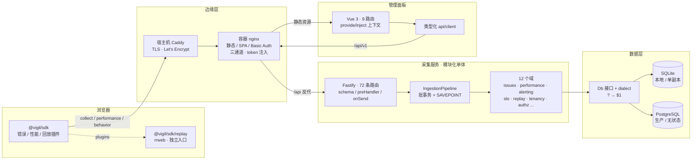

# Vigil 从零到一：一个前端监控平台是怎么搭起来的

> 这不是 API 文档，是**建造记录**：每一步先想解决什么、最小可运行的东西长什么样、
> 怎么证明它没坏、以及当时到底踩了什么坑。
>
> 两条线一起讲：
> - **真实时间线**：`CHANGELOG.md` 里的 v0.1.0（2026-10-12）→ v0.4.0（11-02）→ 当前阶段（11-09）；
> - **重来一遍的推荐顺序**：如果今天从空目录开始，我会照第 1–6 节的顺序再做一次。
>
> 配套阅读：[README.md](../README.md)（现状）、[AGENTS.md](../AGENTS.md)（35 条不变量）、
> [docs/interview.md](interview.md)（面试问答）、[docs/deploy.md](deploy.md)（上线）、
> [docs/integration.md](integration.md)（SDK 接入）。
>
> 文中所有命令都在仓库根目录执行，Node 22。

---

## 0. 先定边界：不做什么，比做什么更重要

动手前先写下来的不是架构图，是**排除清单**。因为「前端可观测性」是个无底洞，
不定边界就会在「要不要做分布式追踪 / 日志检索 / 告警平台」里耗死。

| 做 | 不做 | 理由 |
|---|---|---|
| 错误 / 性能 / 行为 / 回放四通道 | 后端 APM、分布式链路追踪 | 目标是「一条前端错误从浏览器到面板」的完整链路，不是全栈监控 |
| Issue 工单 + 状态机 + 回归 | 工单系统与人的协作流程 | 状态机是数据模型，不是审批流 |
| 组织 / 项目 / 环境 / 版本隔离 | 账号体系、SSO、计费 | 租户是数据边界，登录交给 nginx Basic Auth / 成员令牌 |
| 自研 SDK + 采集服务 | 服务端 agent、日志采集 | 只关心浏览器里能拿到什么 |
| 关系库存全量明细 + 保留策略 | 列存 / 时序库 / 向量库 | 演示规模够用，量级没到换存储的临界点 |
| 5 个可自动跑的闸门 | 完整压测平台 | 先把「静默退化」挡住，压测是下一段路 |

**还有一条产品边界**：行为采集**不记录任何输入内容**。
只记「点了某个按钮」，不记「在搜索框里输入了 xxx」—— 输入内容最敏感，
对定位问题价值最低。这条写进 `AGENTS.md` 第 18 条，明确「不要为了功能更全去采集输入内容」。

**先定目标，伪约束会自己消失**：最初卡了两周的「素材从哪来 / 有没有真实流量」，
在把目标定成「可解释、可验证的最小闭环」之后自动解除 —— 30 条手动素材就够演示，
规模是设计目标（按 1000–5000 条设计），不是启动条件。

---

## 1. Day 0：先跑通一条线，不要先搭架子

### 1.1 目标

一个浏览器页面主动抛错 → 采集服务收到 → 落到 SQLite → 用一条 SQL 查得出来。
**这一天的产出必须能 `curl` 出来**，否则后面所有设计都是纸上谈兵。

### 1.2 先定协议，再写代码

四个 workspace 包，`packages/protocol` 是第一个建的：

```json
// packages/protocol/package.json
{
  "name": "@vigil/protocol",
  "exports": { ".": { "types": "./src/index.ts" } },
  "files": ["src", "README.md"]
}
```

`exports` **只有 `types` 条件**，没有 `import` / `default` —— 这个包里没有任何 JS，
编译后完全擦除，所以 SDK 的体积贡献是 0，也不存在「protocol 要先 build」的构建顺序依赖。

```ts
// packages/protocol/src/error.ts（骨架）
export interface ErrorEvent {
  eventId: string          // 服务端去重键
  appId: string            // 项目 slug
  fingerprint: string      // 客户端算的聚合主键
  category: 'javascript' | 'resource' | 'http'
  kind: 'js' | 'promise' | 'vue' | 'manual'
  message: string
  frames: StackFrame[]
  occurredAt: number
  release?: string
  sessionId?: string
  vitals?: ErrorVitals
  replay?: ReplayPayload
}
export interface CollectEnvelope { appId: string; sdk: SdkInfo; events: ErrorEvent[]; token?: string }
```

> `token` 只有在 **sendBeacon 通道**才进 body —— beacon 不能自定义 header，
> fetch 通道走 `X-Vigil-Token` 头。这个约定在协议注释里写死，免得两边各猜一套。

**为什么协议先行**：SDK 和 collector 是两个独立进程，靠 JSON 通信。
把契约单独成包 + 单独版本号，改字段会体现在依赖树里，消费方升级时看得见。
后来 `CONTRIBUTING.md` 专门加了一条「不要改 protocol 字段名而不升版本」。

### 1.3 最小服务骨架

```ts
// packages/collector/src/app.ts（Day 0 版本）
const app = Fastify({ ajv: { customOptions: { coerceTypes: false } } })

app.post('/api/v1/collect', { schema: { body: CollectBodySchema } }, async (req) => {
  const project = await authenticateProject(req)
  const row = db.get('SELECT id FROM issues WHERE project_id = ? AND fingerprint = ?',
                     [project.id, req.body.events[0].fingerprint])
  if (!row) db.insert('INSERT INTO issues (project_id, fingerprint, title) VALUES (?, ?, ?)', [...])
  db.run('INSERT INTO issue_events (project_id, issue_id, event_id, occurred_at) VALUES (?, ?, ?, ?)', [...])
  return { ok: true }
})

app.get('/api/v1/projects/:id/issues', { preHandler: adminGuard }, async (req) =>
  db.all('SELECT * FROM issues WHERE project_id = ? ORDER BY last_seen DESC LIMIT 50', [req.params.id]))
```

`coerceTypes: false` 是第一天就定的：上报数据里大量字符串字段，
AJV 默认会把 `"1.0"` 悄悄改成数字 `1`，改的是**用户的数据**，版本号不能被动手脚。

**最小数据模型**（后来长成 31 张表，Day 0 只有三张）：

```sql
CREATE TABLE projects  (id INTEGER PRIMARY KEY, slug TEXT UNIQUE, name TEXT);
CREATE TABLE issues    (id INTEGER PRIMARY KEY, project_id INTEGER NOT NULL,
                        fingerprint TEXT NOT NULL, title TEXT, count INTEGER DEFAULT 0,
                        first_seen INTEGER, last_seen INTEGER,
                        UNIQUE (project_id, fingerprint));
CREATE TABLE issue_events (id INTEGER PRIMARY KEY, project_id INTEGER NOT NULL,
                           issue_id INTEGER NOT NULL, event_id TEXT NOT NULL,
                           occurred_at INTEGER, raw_json TEXT,
                           UNIQUE (project_id, event_id));
```

**注意两处一开始就做对的事**：
- `UNIQUE (project_id, fingerprint)` —— 聚合的正确性交给数据库，不靠应用层「先查再插」（并发必出重复行）；
- `UNIQUE (project_id, event_id)` —— 网络重试的同一条事件不会让 count 虚高。

### 1.4 Day 0 的验收

```bash
npm install
npm run dev:collector
curl -s localhost:4318/api/health                     # {"ok":true,...}
curl -s -X POST localhost:4318/api/v1/collect -H 'x-vigil-token: vsk_...' -d '{...}'
curl -s localhost:4318/api/v1/projects/1/issues -H 'x-vigil-admin-token: ...'
```

**判据不是「能跑」，是「同一条错误报两次，列表里只有一行且 count = 2」**。
这一条后来成了 `verify-pipeline.ts` 里的第 2 条断言。

### 1.5 Day 0 就踩到的三个坑

1. **默认数据库路径要相对仓库根解析**，不能相对 CWD。
   `npm run dev:collector` 以 `packages/collector` 为 CWD，`seed:demo` 以根为 CWD ——
   采集服务连 A 库、种子脚本写 B 库，表现是「种子跑完了但面板空空如也」。
   `client.ts:192-200` 用 `../../../../..` 从模块位置推仓库根。
2. **`openDb()` 是异步的，必须 `await`**。迁移没跑完就接第一个请求 →
   「刚启动几秒里上报全部 500」。这个坑在 v0.4 的种子脚本里又犯了一次（漏 await）。
3. **SQLite 默认不开外键**。`schema` 里写的 `ON DELETE CASCADE` 一条都不触发，
   要显式 `PRAGMA foreign_keys = ON`；顺手开 `journal_mode = WAL` 与 `synchronous = NORMAL`。

---

## 2. 阶段一 · v0.1.0（10-12）：能收错误，也能看见

### 2.1 目标

把 Day 0 的裸骨架做成**能给别人用**的东西：SDK 自动采集、脱敏、sourcemap 还原、
多租户模型、双密钥、一个能看的面板。

### 2.2 SDK：从「手动上报」到「自动捕获」

`packages/sdk/src/` 的模块划分，按「浏览器提供了什么事件」来切，不按业务切：

| 文件 | 装了什么监听 | 关键决定 |
|---|---|---|
| `collectors/global.ts` | `window.error`（**捕获阶段 `true`**） | 资源加载失败不冒泡，冒泡监听一条都收不到 |
| `collectors/promise.ts` | `unhandledrejection` | `promise.catch()` 处理过的拒绝不触发 |
| `collectors/network.ts` | 劫持 `fetch` / `XHR` | 默认只报 5xx；必须排除采集端点自身 |
| `collectors/performance.ts` | `PerformanceObserver` 系列 | Web Vitals 自己算，为了和错误关联 |
| `collectors/breadcrumbs.ts` | history 补丁 / 点击 / console | 保留最近 30 条，**不采输入内容** |

两个「不加就出事」的护栏：

```ts
// 模块求值时抓住原生 fetch，晚一步抓到的就是补丁版 → 无限递归
const rawFetch = globalThis.fetch.bind(globalThis)
const isSelf = isCollectorUrl(url, options.endpoint)   // 上报→拦截→再上报→页面被打死
```

`network.ts` 默认 `httpErrorPolicy: '5xx'`，因为前端 4xx 多是业务语义
（余额不足、订单状态变化、登录过期），报进来只会淹没真错误。

### 2.3 指纹：整个项目最核心的一个函数

```ts
// packages/sdk/src/fingerprint.ts（简化）
export function computeFingerprint(input: FingerprintInput): string {
  if (input.category === 'resource') return hashString(`resource|${tag}|${srcWithoutQuery}`)
  if (input.category === 'http')     return hashString(`http|${method}|${pathOf(url)}|${status}`)

  const appFrames = input.frames.filter(f => !isSdkFrame(f) && !isThirdPartyFrame(f))
  const key = (appFrames.length ? appFrames : input.frames).slice(0, 3)
    .map(f => `${f.functionName ?? '?'}@${stripBuildHash(basename(f.filename))}`).join('>')
  return hashString(`js|${input.name ?? 'Error'}|${key || 'msg:' + normalizeMessage(message)}`)
}
```

三条准则（后来写进 `AGENTS.md` 前 3 条不变量）：

1. **用 `category` 不用 `kind`** —— Vue 捕获和全局捕获到同一个错误必须是同一条；
2. **不含行号列号** —— 改一行代码不该让错误的历史断掉；
3. **剥构建 hash** —— `index-DnB3xK2l.js → index.js`，否则每发一次版所有错误都变新的。

`hashString` 用 FNV-1a + djb2 拼 16 位十六进制，**不用 `crypto.subtle.digest`**：
它是异步的，而指纹必须在 `window.onerror` 这个同步回调里当场算出，
异步意味着这条错误带着空指纹进队列，聚合直接废掉。

### 2.4 脱敏：在上报之前，不是落库之后

`mask.ts` 的两套集合 + 词段拆分：

```ts
const EXACT_KEYS = ['key','auth','authorization','token','password','code', ...]  // 整键
const SENSITIVE_PARTS = ['password','apikey','idcard','phone', ...]              // 词段
splitKeyParts('accessToken')  // → ['access','token'] → 命中
```

**为什么不用子串匹配**：`monkey` 含 `key`、`zipcode` 含 `code`；
`code` 是整键敏感（OAuth `?code=`），但 `statusCode` / `errorCode` 只是词段，不该抹。

`scrubText` 四条正则顺序固定：`JSON_ASSIGN → AUTH → CREDENTIAL → ASSIGN`。
AUTH 必须在 CREDENTIAL 之前，否则得到 `Authorization: *** ***`，凭证反而留在后面。

### 2.5 传输：两个产物、两条发送路径

`vite.lib.ts` 用 Vite lib 模式出 ESM + IIFE + vue + replay 四个产物，**分四次单独构建**：

```bash
vite build                          # dist/index.js + index.iife.js
vite build -c vite.vue.config.ts    # dist/vue.js（只 ESM）
vite build -c vite.replay.config.ts # dist/replay.js + replay.iife.js
tsc -p tsconfig.build.json          # 只发 .d.ts
```

**为什么单入口单构建**：多 entry 会把公共代码抽成共享 chunk，
`<script type="module">` 直接引就断；Rollup 的 `inlineDynamicImports` 与多入口互斥。
**只有第一个构建能 `emptyOutDir: true`**，否则第二次会把第一次的产物删掉
（症状：构建成功但 `dist/index.js` 不存在）。

**为什么 IIFE 必须在 `<head>` 同步加载**：`<script type="module">` 默认 defer，
初始化晚于 HTML 解析；而 `` 的失败在**解析过程中**就触发完了。
实测同一页面：IIFE 抓得到首屏图片 404，ESM 一条都收不到。

`transport.ts` 按 48KB 切批（浏览器超过 64KB 会**静默丢弃**，不报错不重试），
`pagehide` 时优先 `sendBeacon`（token 进 body），false/异常落回 `fetch(keepalive)`。
**没有自动重试循环** —— 重复上报安全靠 `eventId` + 服务端唯一索引，不靠 SDK 重试。

### 2.6 租户与双密钥

组织 → 团队 → 项目，项目下挂环境与版本。建项目时出两把密钥，
`project_keys` 只存 `sha256` 哈希，明文**只在创建/轮换时返回一次**：

| 密钥 | 用途 | 放哪 |
|---|---|---|
| `vsk_` runtime | 上报 | 前端代码（可公开） |
| `vup_` upload | 上传 sourcemap | **只在 CI 里** |

`appId` 传的是项目 **slug**（中文名会逐字转拼音，见第 6 节）。
sourcemap 只上传到 collector、不进静态资源目录 —— 浏览器能下载到的文件攻击者也能下载到，
那等于公开源码。服务端还原时还要处理**列号 1-based（JS 栈）vs 0-based（sourcemap）**，
显式 `-1` / `+1`，差一位不报错只是位置偏。

### 2.7 阶段一的验收与坑

```bash
npm run verify          # 此时约 10 条断言：真 Chromium → 真 SDK → 真 HTTP → 真 SQLite
```

| 坑 | 症状 | 修法 |
|---|---|---|
| 通道地址直接拼接 | `.../collect/api/v1/behavior` 404 且**不报错**，行为数据一条都没有 | `resolveApiRoot()` 推导兄弟通道 |
| ESM 接入漏首屏资源错误 | 面板上没有资源类错误 | 出 IIFE + `<head>` 同步加载 |
| 采集服务自己上报被拦截 | 无限递归把页面打死 | `isCollectorUrl` |
| 面板代理端口漂移 | Vite 端口占用时静默 5173→5174 | `strictPort: true` |

---

## 3. 阶段二 · v0.2.0（10-20）：把「日志」变成「工单」

### 3.1 目标

错误不是一条记录，是**一个工单**：有状态、负责人、评论、活动历史，
并且能回答「这个 bug 是不是我上次的修复引入的」。

### 3.2 状态机：先写纯函数，再写服务

```ts
// packages/collector/src/domains/issues/state-machine.ts
export type IssueStatus = 'unresolved' | 'resolved' | 'archived'
export type IssueSubstatus = 'new' | 'ongoing' | 'escalating' | 'regressed'

export function transition(state: IssueState, event: IssueTransition): TransitionResult {
  switch (event.type) {
    case 'created':        return onCreated(state, event)
    case 'event_received': return onEventReceived(state, event)
    case 'resolve':        return onResolve(state, event)
    // ... 8 种事件
    default: {
      const _exhaustive: never = event   // 加事件类型时漏分支 = 编译不过
      return _exhaustive
    }
  }
}
```

**关键决定**：状态是**两层**（status × substatus），不是六个并列状态。
`transition` 是纯函数，同时产出「新状态 + 列变更 + 活动流草稿」——
服务层不许另写 if 判断流转，「每次流转该写什么活动流」也是函数的一部分，不靠调用方记得写。

### 3.3 Resolve with Release（这个项目最值钱的一个机制）

```ts
export function isNewerVersion(candidate: string, baseline: string): boolean {
  const norm = (v: string) => v.replace(/^v/, '').split(/[+-]/)[0].split('.')
  const a = norm(candidate), b = norm(baseline)
  const isNum = (s: string) => /^\d+$/.test(s)
  if (!a.every(isNum) || !b.every(isNum)) return false   // 非数字保守判否
  for (let i = 0; i < Math.max(a.length, b.length); i++) {
    const d = Number(a[i] ?? 0) - Number(b[i] ?? 0)
    if (d !== 0) return d > 0
  }
  return false
}
```

**为什么不能字符串比较**：`'1.4.10' < '1.4.3'` 在字典序下成立，回归就判不出来。

`onResolve` 记 `resolvedInRelease`（存**版本字符串副本**，不存自增 id ——
版本记录可能被删，而回归判定是历史事件）；`onEventReceived` 在 `resolved` 状态下比较新事件的
release，只有真的更新才转 `unresolved / regressed`。在解决它的那个版本或更早出现 → **噪音**，不重开。

### 3.4 告警 / 性能 / 面板同时进场

| 加的东西 | 最小实现 | 为什么这时候加 |
|---|---|---|
| 告警引擎 | 规则 × 通道 × 去重静默，定时扫描（pull） | 工单有状态之后，「新问题 / 数量突增」才有意义 |
| 性能 RUM | Web Vitals / 长任务 / 接口 span / 路由事务 | 报错事件要带**当刻的性能快照**，才能回答「这个错误是不是拖慢了这页」 |
| 多页面板 | 顶栏 + 侧栏 + 项目上下文，9 条路由 | 数据维度变多，一个页面放不下 |

**性能与错误走两条独立通道**：性能数据量大且绝大多数正常，
混在一起就没法「错误全量、性能采样（默认 0.1）」。

### 3.5 阶段二修掉的两个真 bug

1. **应用层查重 → 数据库 UNIQUE 约束**：「先查再插」在并发下必然出重复行。
2. **回放比行为汇总先到是常态**：错误立即上报，行为汇总要等攒批或页面卸载；
   原实现只 `UPDATE` 会话行，这一行永远建不出来 —— 「回放事件在库里，但会话列表里看不到它」。
   修法是 `ensureSessionRow()`，写回放时保证会话行存在。

### 3.6 阶段二的验收

```bash
npm run verify          # 33 条断言逐步长出来：聚合、resolve、回归、同版本噪音、活动流
```

**最该先写的三条断言**（顺序不能反）：
- 同一个错误报两次 → 一条 Issue、`count = 2`
- 在 `1.0.0` resolve → 在 `1.1.0` 再报 → `substatus = regressed`
- 在 `1.0.0` 再报 → 仍是 `resolved`

---

## 4. 阶段三 · v0.3.0（10-28）：把「现场」补上

### 4.1 目标

只知道「报了什么错」不够，还要知道「用户当时在干什么」。
同时把时间维度、双库、存储上界这三件工程债一起还了。

### 4.2 会话回放：核心不感知它

```ts
// packages/sdk/src/plugin.ts
export interface VigilPlugin {
  setup(host: VigilPluginHost): void
  enrich?(event: ErrorEvent): void
}
// 核心只给能力，不给整个客户端
interface VigilPluginHost {
  options: ResolvedOptions
  get sessionId(): string
  post(path: string, body: unknown): void
  addContext(ctx: Partial<EventContext>): void
}
```

`VigilClient` 的 import 列表里**没有 rrweb**；回放是独立入口 `@vigil/sdk/replay`，
`setupPlugins()` 同步 for 循环安装，事件发出前 `runPluginEnrich` 让回放插件把
`recorder.peek()` 挂到 `event.replay` 上。
**回放不是持续上传整段会话，是出错时随错误带上去** —— 没出错的会话没人看。

### 4.3 缓冲区：整个回放模块的命门

```ts
// packages/sdk/src/replay/buffer.ts（纯函数，8 条单测盯着）
export const FULL_SNAPSHOT_TYPE = 2, META_TYPE = 4

export function applyReplayEvent(state, event, maxBytes, sizeOf = estimateSize): BufferResult {
  if (event.type === FULL_SNAPSHOT_TYPE) {
    return { events: [...state.events.filter(e => e.type === META_TYPE).slice(-1), event],
             overflow: false, ... }                       // 全量快照不受预算限制，但保留 Meta
  }
  if (state.bytes + sizeOf(event) > maxBytes) {
    return { events: [], bytes: 0, overflow: true, droppedSegments: state.droppedSegments + 1 }
    // 调用方看到 overflow → restart() → 重新取全量快照
  }
  return { events: [...state.events, event], bytes: state.bytes + sizeOf(event), ... }
}
```

**为什么不丢中间的**：rrweb 的流是「一个全量快照 + 一串增量」，中间丢任何一段，
后面的增量**全部对不上**，而播放器**不报错，只是画面全乱** —— 监控面板自己坏了却没人知道。
事件编号不能猜（2 / 3 / 4；NodeType 0 / 2 / 3），写成 0 会让缓冲区永远不重置。
Meta 带原始视口尺寸，重置时必须保留，否则回放被裁切。

### 4.4 服务端：从「整段覆盖」到「增量写」

旧实现每次上报「先 DELETE 整会话，再逐条 INSERT」：3000 事件的会话第 5 次上报
要删 3000 + 插 3000 条单条 SQL，**O(n²)**。改成按链追加：

```sql
-- 链的身份 = 第 0 条（全量快照）的时间戳
SELECT timestamp FROM replay_events WHERE project_id = ? AND session_id = ? AND seq = 0;
-- 相同 → 从 MAX(seq)+1 只追加尾部；不同 → DELETE 整条旧链
```

**不能靠「seq 已存在就跳过」**：那会静默拼出「新快照 + 旧增量」的混合流。
另外**每个会话只保留最新一份流**（客户端缓冲是滚动窗口，第 2 个错误带的窗口更长），
代价是回放不精确对应每个错误的时间点 —— 这个限制写进 README，不藏着。

### 4.5 时间维度：一个顶栏控件，改的是全局口径

顶栏加了「最近 1 小时 / 24 小时 / 7 天 / 30 天」，所有页面跟随。
给了范围，统计口径就从「问题表的累计快照」换成「**窗口内实际发生过**」：

```sql
-- 必要条件预过滤：窗口内发生过 ⇒ last_seen >= since 且 first_seen < until
WHERE i.project_id = ? AND i.last_seen >= ? AND i.first_seen < ?
-- CTE 先算出符合条件的 issue 集合，再在这些 issue 的事件里聚合 window_count
WITH scope AS (...), wc AS (SELECT issue_id, COUNT(*) n FROM issue_events WHERE ... GROUP BY issue_id)
SELECT ... FROM scope INNER JOIN wc ...
```

三条容易错的：
- 排序也跟着换（有窗口按 `window_count`），次级排序固定 `i.id DESC` 防翻页重复；
- 错误率分母是页面访问数，`transactions = 0` 时返回 **null 而不是 0**；
- 「按天」的桶边界要对齐**本地午夜**：`(col + tzOffset) / bucketMs`，符号反了会把东八区算成西八区。

### 4.6 双库：方言层是这一阶段最重的工程

本机没有 Docker（缺 WSL2）、没装 PG，但生产必须 PG。于是：

```ts
// infra/db/dialect.ts
pk(dialect)      // SQLite: INTEGER PRIMARY KEY | PG: SERIAL PRIMARY KEY
ts(dialect)      // SQLite: INTEGER           | PG: BIGINT（epoch 毫秒会溢出 int4）
bool(dialect)    // 两边都用 INTEGER（PG 的 BOOLEAN 不接受整数 1）
json(dialect)    // SQLite: TEXT             | PG: JSONB
bucketExpr(...)  // 时区分桶，两边生成不同表达式
```

```ts
// infra/db/postgres.ts：逐字符扫描，跳过字符串/标识符/注释，把 ? 翻成 $1
toDollarPlaceholders('SELECT * FROM t WHERE a = ? AND b LIKE \'a?b\'')
// → 'SELECT * FROM t WHERE a = $1 AND b LIKE \'a?b\''
```

**领域代码统一写 `?`**，100 多处查询一个字符都不用改。
`buildSchema(dialect)` 同一份 DDL 生成两套表；`migrate.ts` 查表结构时
PG 用 `information_schema.tables`、SQLite 用 `sqlite_master`，绝不混用。

**怎么证明 PG 上真能跑**：引入 `@electric-sql/pglite`（**WASM 编译的真 PostgreSQL 本体，不是模拟器**），
`tests/postgres.test.ts` 跑完整领域链路：成员凭据 / RBAC / 回填 / 全部表 / 错误聚合 /
状态机 / 分位数 / 回放行为 / 趋势分桶 / 占位符翻译 / 批量 VALUES。
CI 和本地都能跑，不需要装 PG。

### 4.7 存储上界与配额

| 加的东西 | 为什么 |
|---|---|
| `retention/service.ts` | `retention_days` 之前只是个字段没人读；回放单会话几百 KB，三个月后是磁盘满不是查询慢 |
| `project_usage` 计数表 | 配额检查在**每个上报请求**上，`COUNT(*)` 随事件数线性增长 |

保留策略三约束：**分批删**（一条 DELETE 十万行会长时间持锁，上报全排队）、
**每轮上限**（5000 × 20 批）、**不允许重入**（`running` 标志）。
配额计数**单调递增**（否则等清理跑完配额自己回来了），且与项目同时创建。

### 4.8 阶段三的三个真 bug（都在 `CHANGELOG.md` 里）

1. **回放增量链缺全量快照** → 播放器静默播不出来；
2. **行为通道地址拼错** → 404 且不报错，行为数据一条都到不了（见第 2.7 节）；
3. **`writeActivity` 丢返回值** → 「谁做的操作」永远记不上。

---

## 5. 阶段四 · v0.4.0（11-02）：从「看得见」到「能决策」

### 5.1 目标

功能已经够多了，这一阶段补的全是**工程可信度**：
怎么知道系统现在好不好、怎么知道改动没把系统悄悄弄坏、怎么把「能不能发版」变成可判定的。

### 5.2 SLO：把「错误率涨了」变成「这个月还能不能发」

```ts
// domains/slo/service.ts
// 窗口切小步，每步单独判达标；无流量的步跳过
sli = goodSteps / evaluatedSteps
burnRate = errorRatio / allowedErrorRatio
```

**为什么分步判定**：整体平均会把「99.99% 的时间正常、最后 1 分钟全崩」平均成 99.99%，
而用户那一分钟全在挨骂。**步长是定义的一部分**（30 天窗口配 1 小时步 = 720 步，
偶发一次错只掉 0.14%；配 1 天步 = 30 步，同样的错掉 3.3%），
所以 `normalizeStep` 要求步长整除窗口，定义时就拦住。

**多窗口多燃烧率**（SRE 手册）：4 对长短窗口，`(3d,6h,1) / (1d,2h,3) /
(6h,30m,6) / (1h,5m,14.4)`，**两个窗口同时超阈值才告警**。

**策略与命令分离**：`domains/slo/gate.ts` 是纯函数 `decideSloGate()`（9 条单测），
`scripts/slo-gate.ts` 只负责读库、调策略、翻译退出码（0 放行 / 1 阻断 / 2 闸门自身故障）。
理由：「什么情况阻断发布」是业务规则，不该只活在命令行里。

> ⚠️ **诚实的现状**：CI 里只有 `slo:gate -- --all` 空库冒烟，只保证脚本不烂，
> **挡不住发布**。要真正当门禁，得让流水线读得到项目库。这条留在 README「待做」里，没有偷偷勾掉。

### 5.3 告警投递：从「同步发」到「入队 + worker + 死信」

```
AlertEvaluator（同步，每 60s）   → 判触发 / 记 incident / 入队   ← 不等通道
alert_deliveries 表              → pending → sent / dead（兼作队列与死信）
DeliveryWorker（每 10s）         → 按 next_attempt_at 取、发送、排重试
```

**为什么切**：评估是同步的，一个卡住的 webhook 会把整轮评估拖住 → 下一轮排不上 → 告警停摆。
两层重试各管各的：发送内部 5s 超时 / 10s 总预算 / 300·1000ms 退避（只重试网络错误、5xx、429，
**4xx 不重试**）；worker 跨轮 1min → 5min → 30min → 2h → 12h，用完转死信，可人工重放。

**`markDelivery` 状态必须显式传**：用布尔判断的话「终态失败」和「还要重试」分不开，
终态写成 pending + 无下次时间 = 立即再取 = 永远进不了死信。

### 5.4 五个闸门：把「静默退化」变成会红的数字

这一阶段最重要的事不是加功能，是**给每一类「不会让单测挂、也不会报错」的退化装一个探针**。

| 脚本 | 判据 | 怎么测 |
|---|---|---|
| `audit-ui.mjs` | 15 条 | 真 Chromium + `getComputedStyle`：字阶对比、颜色收敛、焦点环、点击目标、5 个宽度无横向溢出、reduced-motion |
| `audit-query-plans.ts` | 1 条 | `app.inject()` 插桩取真实 SQL → 复制库、把 11 张增长表灌到 2 万行 → `EXPLAIN QUERY PLAN` 扫 `SCAN` |
| `audit-ingest-calls.ts` | 6 条 | spy Db 数往返 + 包装 better-sqlite3 底层句柄数 `COMMIT`；差值法 `(calls20 - calls1)/19` |
| `audit-tenant-scope.ts` | 1 条 | 从 `sqlite_master` 读每张表的租户列 → 打 41 条管理接口 → 扫每条 SQL |
| `audit-publish.ts` | 1 条 | `npm pack --dry-run --json` 的真实清单：.d.ts 引用、依赖位置、tarball 无 .map、publishConfig、体积 ≤ 800KB |

**共同设计原则**：
- **不靠猜**：SQL 从运行时插桩拿，tarball 内容从 `npm pack` 拿；
- **不硬编码表清单**：`tenantColumns()` 从库结构读，新表上线自动纳入检查；
- **豁免要可见**：三类结构上安全的 SELECT 逐条打印理由，**UPDATE / DELETE 一律不豁免**；
- **断言要有鉴别力**：加索引前先确认「去掉索引这条断言会挂」；故意把
  `VIGIL_INGEST_BUDGET=3` 调低，看闸门真的变红。

### 5.5 摄入路径压到「3 次往返 / 1 次提交」

```
1. SELECT issues WHERE fingerprint                        ← 找 Issue
2. INSERT issue_events ON CONFLICT DO NOTHING             ← 写入本身兼作查重
3. UPDATE issues SET count / last_seen / ...              ← 更新聚合
```

第 2 步以前是两条（先 SELECT 查重再 INSERT）。改成 `ON CONFLICT DO NOTHING` 后
`changes === 0` 就是网络重试的同一条事件。
每批 20 条 = **一个事务 + 每条一个 SAVEPOINT**（PG 里一条语句失败会中止整个事务，
一条坏事件会把另外 19 条带走）。实测文件库 20 条：逐条 4.3ms → 整批 1.1ms。

另一个被闸门抓到的浪费：`SourcemapResolver` **只缓存命中、不缓存未命中**，
没上传 map 的项目（很常见）每条事件都要白跑一次库。
改成命中/未命中分开缓存（TraceMap 是重对象封 32 条，未命中条目很轻封 4096 条）。

### 5.6 阶段四修掉的五个真 bug

| bug | 症状 | 修法 |
|---|---|---|
| 去重 ID 漏了 release | **回归检测被绕过**，只在同毫秒触发、失败信息指向状态机 | `canonicalJson` 覆盖全载荷 + 排序键 |
| PG 事务形同虚设 | `BEGIN` 在一个连接、语句走 `pool.query` 到别的连接 | `AsyncLocalStorage` 绑定事务连接 |
| 参数校验错误 500 | Fastify schema 错误不是 `AppError`，被兜底成内部错误还刷日志 | `setErrorHandler` 单独接 `validation` 分支 |
| 种子脚本漏 `await` | 领域服务拿到 Promise，报 `this.db.get is not a function` | 补 await |
| 告警规则 / issue 写操作缺租户范围 | 隔离依赖调用链，漏一处就串数据 | 每条语句自带范围 + 闸门 |

**「PGlite 测不出 PG 事务 bug」这条特别值得记**：PGlite 是单连接的，
天然不会出现「语句跑到别的连接上」。所以另写 `postgres-transaction.test.ts`
用**假连接池**（池和借出的连接是不同身份）验证语句归属。
**单连接的实现证明不了多连接的行为** —— 这类差异要专门造。

---

## 6. 阶段五 · 当前（11-09）：从「能跑」到「能给人用」

### 6.1 目标

补三笔账：「表有、逻辑没用」的债、上线形态、以及闸门到底可不可信。

### 6.2 RBAC 与审计

早期只有一把全局 `VIGIL_ADMIN_TOKEN`，70+ 路由共用一个 guard，没有成员、没有角色、
`audit_log` 表躺着没人写。这一阶段接上：

```ts
// domains/authz/service.ts
export function requiredAction(method: string, path: string): Action {
  if (method === 'POST' && /^\/api\/v1\/organizations\/?$/.test(path)) return 'superadmin'
  if (MANAGE_PATH.test(path)) return method === 'GET' ? 'read' : 'manage'
  if (ROTATE_KEY_PATH.test(path)) return 'manage'
  if (method === 'DELETE') return 'manage'
  if (['GET','HEAD','OPTIONS'].includes(method)) return 'read'
  return 'write'
}
```

**为什么集中在一处**：逐路由声明漏配一个就是一次越权，而且**没有任何测试会报警**。
角色矩阵：组织 `owner > admin > member`，项目 `owner > editor > reader`；
跨组织一律 403。成员凭据 `vmk_` 只存哈希、可单独撤销。

**身份解析顺序是硬约束**：
```ts
for (const token of [adminToken, bearer]) if (isAdminToken(token)) return SUPERADMIN
for (const token of [memberToken, bearer]) { /* 查 member_keys → member Principal */ }
```
先认成员令牌的话，管理员（Basic Auth + nginx 注入 admin token）会被**降级成只读演示账号**：
页面能开、数据能看，就是什么都改不了。`authz.test.ts` 有一条专门锁死这个优先级。

**审计只记成功的写操作**，且 `data_json` 只有 `{status}` ——
创建项目、签发凭据的响应里有明文密钥，**审计表不能变成第二个密钥库**。
`onSend` 而不是 `onResponse`：后者 fire-and-forget，会出现「请求已返回、审计还没落库」。

### 6.3 团队路由：把「建了表没用」的债还掉

`teams` / `team_members` 表早就建好、`createTeam` 也实现了，但没有路由。
补齐 8 条 CRUD / 成员管理接口后，**闸门立刻抓到 3 处真越权写法**：

```sql
-- 补之前（和 v0.2 修过的告警规则同一个毛病）
UPDATE teams SET name = ?, slug = ? WHERE id = ?
-- 补之后
UPDATE teams SET name = ?, slug = ? WHERE id = ? AND organization_id = ?
```

同时把 v0.5 新增的 `/me` / 成员 / 凭据 / 团队 / 项目成员 / 审计路由全塞进两个闸门的接口清单：
查询计划覆盖 55 → 75 条查询，租户隔离记录 92 → 139 条语句。
11 处 offender 里 8 处是结构上不可能串数据的 SELECT（按主键解析归属 / 主键点查 / JOIN 范围），
按精确规则豁免并逐条打印理由；**写操作一律不豁免**。

### 6.4 公开只读 Demo 与三通道

让陌生人不用私聊就能看面板，是这个项目从「作品」变成「可展示物」的一步。

```nginx
# deploy/nginx/default.conf.template
map "$http_authorization|$http_x_vigil_member_token" $vigil_public_channel {
    default     0;
    "~^\|vmk_"  1;                        # 无 Basic Auth + 带 vmk_ 演示令牌
}
location /api/ {
    error_page 418 = @vigil_public_api;
    if ($vigil_public_channel) { return 418; }
    include /etc/nginx/vigil-auth.conf;   # Basic Auth
    proxy_set_header x-vigil-admin-token "${VIGIL_ADMIN_TOKEN}";
}
location @vigil_public_api {
    auth_basic off;
    proxy_set_header x-vigil-admin-token "";   # 关键：绝不注入管理员令牌
    proxy_set_header x-vigil-member-token $http_x_vigil_member_token;
}
```

| 通道 | 结果 |
|---|---|
| A 匿名 + `vmk_` reader 令牌 | 200 只读，写操作 403 |
| B 匿名无凭据 | 401 |
| C Basic Auth 管理员 | 200 + admin token → superadmin |

演示令牌由 `scripts/seed-demo-member.sh` 在线上 PG 幂等签发（org=1 / project=1 的 reader），
容器启动时 `50-vigil-demo-config.sh` 把它写进 `/config.js`；
`index.html` 在**主 bundle 之前**加载 `config.js`，`api/client.ts` 优先读 localStorage 的用户令牌。

**真机实验得出的三条结论**（都写进注释了）：
1. `auth_basic $var` 里变量求值成 `"off"` **nginx 照样弹登录框**，只认字面量 `off`；
2. `error_page 418` + named location 里 `proxy_pass` **会保留原始 URI 和 POST body**；
3. map 正则一开始写成 `"~^\|~^vmk_"`（两个 `^` 永不匹配），A 通道一直 401，
   还误以为是 named location 丢了 body —— 定位过程是先做一个最小 nginx 容器做语义实验。

前端身份标签改走 `/me`：靠 localStorage 猜的话，管理员浏览器里往往同时存着演示令牌，
会显示「只读演示」。`fetchCurrentPrincipal()` 失败返回 null 而不抛异常 —— 没登录是合法状态。

### 6.5 零编译部署

```bash
# 服务器（1.6GB 内存）只做这三步，绝不 build
git pull && docker compose pull && docker compose up -d
```

`.github/workflows/images.yml` 用 matrix 构建 `collector` / `dashboard` 两个 target 推 GHCR
（`main` + short sha 双 tag），`docker-compose.yml` 只写 `image:`。
**为什么**：生产机 1.6GB 内存，vite + tsc + node-gyp 同时编译会把它压到 sshd 都无响应
（真实发生过一次，最后从控制台强制重启）。本地要自编才叠加 `docker-compose.build.yml`。

容器启动时三份脚本按序执行：`30-vigil-subst.sh`（渲染 proxy 配置，envsubst 只放行一个变量）、
`40-vigil-auth.sh`（按需生成 `.htpasswd`；**没有密码时写空文件**表达「不启用」）、
`50-vigil-demo-config.sh`（写 `/config.js`）。

### 6.6 闸门接进 CI：这一轮最扎心的发现

README 一直写着「5 个自动闸门、24 条判据」，`ci.yml` 里**只挂了 2 个**。
根因不是忘了，是 `audit:plans` / `audit:scope` 依赖 `data/vigil.db` 里的真实数据，
干净 runner 上连 `data/` 都不存在，挂上去会立刻红，于是干脆装作没这回事。

```yaml
# .github/workflows/ci.yml（ci job 关键顺序）
- run: npm run slo:gate -- --all          # 空库冒烟，必须在 seed 之前
- run: npm run seed:demo -- --reset        # 种子里有一条「预算烧完」的 SLO
- run: npm run audit:plans
- run: npm run audit:scope
```

**顺序不能挪**：种子里为了让面板能演示两种状态，故意放了一条 `exhausted` 的 SLO；
先播种会让发布闸门按「预算耗尽」退出 1，把 CI 无端染红。

`dashboard` job 里，**起服务和跑测试必须在同一个 step**：
GitHub Actions 每个 `run` 块是独立 shell，块结束时里面用 `&` 起的后台进程会被杀掉。
跑的是 `vite preview`（生产构建产物）而不是 dev server，且 `preview.proxy` 要显式再写一遍
（继承 `server.proxy` 的行为在不同 vite 版本/平台上并不一致）。

### 6.7 中文 slug 与界面回归

- **中文 slug**：`pinyin-pro` 逐字符只转汉字 —— 整段丢给 `type:'array'` 会把
  `Vue3` 拆成 `V/u/e/3`，英文单词全散。`线上应用 → xian-shang-ying-yong`。
  只影响新建，已有 slug 不回填。
- **窄屏溢出**：`audit:ui` 本地 12/15，八个页面在 320/375/414px 一起溢出，
  溢出量固定 `464 - 视口宽`。根因是新加的「身份标签 + 登录成员」把顶栏右侧撑到约 464px，
  而 `.topbar-actions` 是 `flex: 0 0 auto` 死不收缩。改成窄屏**换行**而不是继续藏控件 → 15/15。

### 6.8 阶段五的验收（全绿）

```
本地：337 单测 · typecheck · lint · 闸门 1+1+6 · 面板 57/57 · 界面 15/15
CI ：run 42619970332 双 job 全绿（含新增三步闸门）；Images 42619970373 推镜像成功
线上：三容器 healthy · 部署冒烟 5/5 · 三通道冒烟 6/6 · 管理员 /me = superadmin
      镜像内 slugify('线上应用') = xian-shang-ying-yong
```

---

## 7. 横切：六个阶段都遵循的工程纪律

1. **验证一律用数字，不看截图**。`AGENTS.md:56`。截图是给人看的，闸门是给机器判的；
   `audit:ui` 输出的 8 张静帧是**副产物**，不是判据。
2. **每个阶段先定验收命令，再写实现**。`npm run verify` 的断言数从 Day 0 的 1 条长到 33 条，
   每加一个能力就先补一条能区分身份的断言。
3. **纯函数承载业务规则**。状态机、SLI 判定、发布策略、回放缓冲、指纹计算、
   优先级参考实现 —— 都抽成可单测的纯函数，服务层只做编排与 IO。
4. **正确性交给数据库，不交给调用链**。UNIQUE 约束、UPSERT、事务、SAVEPOINT、
   外键级联；同样地，**租户范围写进每条 SQL**，不靠「鉴权层已经查过了」。
5. **注释要写「为什么」和「踩过什么」**，不是复述代码。仓库里最有价值的注释几乎都是
   「⚠️ 曾经…症状是…」；结论过期时也要回头更正（窄屏那条注释就被改过一次）。
6. **不做的东西要明确写下来**。`AGENTS.md` 35 条不变量 + `CONTRIBUTING.md` 4 条「不要做的事」
   + README「待做」6 条，都是防止下一轮（尤其是 AI 辅助编码时）把上一轮的决策改回去。

---

## 8. 架构决策记录（ADR 速查）

> 完整论证散在 README「关键设计决策」与源码注释里，这里是可快速索引的一行版。

| # | 决策 | 一句话理由 | 代价 / 限制 |
|---|---|---|---|
| 1 | 模块化单体，不拆微服务 | 告警读 Issue 状态、性能关联错误，三域紧耦合 | 单机部署，多副本要先换 PG |
| 2 | protocol 纯类型零运行时 | 线上契约单独成包，编译后零体积、无构建顺序 | 改字段要同步四处 |
| 3 | `import type` 共享协议 | 编译期擦除，运行期零依赖 | 面板不共享（命名本就不统一） |
| 4 | SQLite + PG 双库 / 方言层 | 本地没 Docker，生产要无状态 | SQL 必须两边都能跑，用 PGlite 验 |
| 5 | 不用 ORM | 大量手写 SQL（CTE、LN/EXP、UPSERT、时区分桶） | 换库要自己维护方言 |
| 6 | 三条上报通道分开 | 错误全量 / 性能采样 / 回放体积大两个数量级 | 地址要推导，不能拼接 |
| 7 | 指纹客户端算、category 分组 | 客户端有完整栈；同步回调里必须当场算出 | 服务端必须校验格式（**当前缺**） |
| 8 | 指纹不含行列号 / 构建 hash | 改代码或发版不该让错误历史断掉 | 不同位置的同类错误会合并 |
| 9 | 聚合靠 UNIQUE + UPSERT | 应用层先查再插并发必出重复行 | 依赖数据库约束 |
| 10 | `ON CONFLICT DO NOTHING` 兼查重 | PG 下少一次网络往返 | 冲突时 `changes=0` 要处理空壳 Issue |
| 11 | 状态机两层 + 纯函数 | 服务层另写 if 迟早分叉；活动流是函数的一部分 | 状态组合要穷尽测试 |
| 12 | Resolve with Release | 回答「是不是上次修复引入的」 | 版本比较要按语义，不能字典序 |
| 13 | 回放独立入口 + 插件系统 | rrweb 体积大、多数人不需要、隐私合规 | 核心与插件契约要稳定 |
| 14 | 增量链从全量快照开始 | 丢中间段会静默播不出来 | 缓冲区满只能整体重取，丢更早历史 |
| 15 | 每会话只存最新一份回放 | 存储有界，不随错误数膨胀 | 不精确对应每个错误时刻 |
| 16 | 脱敏在采集端、按词段匹配 | 不把隐私复制进新库；子串匹配会误伤 | 服务端兜底尚未实现 |
| 17 | 双密钥分离、只存哈希 | 上报密钥可公开，上传密钥能污染错误栈 | 明文只在创建时返回一次 |
| 18 | 配额计数表单调递增 | 热路径不 `COUNT(*)`；保留清理不该让配额回退 | 计数与真实行数不等价 |
| 19 | 限流按项目 + 进程内令牌桶 | IP 是用户的不是项目的 | 重启清零、多实例各算各的 |
| 20 | 权限规则集中在 `requiredAction` | 逐路由声明漏一个就是越权且无测试报警 | 新路由形态变化要同步正则 |
| 21 | 审计不记 body | 响应里有明文密钥 | 事后无法复现完整请求内容 |
| 22 | 告警 pull + 入队 + worker | 事件驱动热路径反查规则更贵；同步等通道会拖停引擎 | 告警有最多 60s 延迟 |
| 23 | SLI 分步判定、无流量步跳过 | 整体平均会掩盖短时全崩 | 步长是定义的一部分，必须整除窗口 |
| 24 | 发布策略放领域层 | 业务规则不该只活在命令行 | 还没接进真实发布流水线 |
| 25 | 闸门从运行时取事实 | SQL 靠插桩、tarball 靠 `npm pack`，不靠猜 | 闸门自身也要有反例验证 |
| 26 | 一个对外入口 + nginx 注入 token | 采集服务暴露端口 = 两份攻击面 | nginx 配置复杂度上升 |
| 27 | CI 推镜像、服务器只 pull | 1.6GB 机器编译会把 sshd 压垮 | 依赖 GHCR 可用性 |
| 28 | 行为不记录输入内容 | 隐私边界是设计出来的 | 回答不了「用户输了什么」 |

---

## 9. 从零复现：完整命令清单

### 9.1 本地起一套

```bash
git clone https://github.com/Liao-wenxuan/vigil.git && cd vigil
npm ci                                  # Node 22；better-sqlite3 是原生模块
npm run demo                            # Windows：一键播种 + 采集服务 :4318 + 面板 :5174
# 或分开起：
npm run seed:demo -- --reset
npm run dev:collector                   # 注意带 VIGIL_ADMIN_TOKEN，见下
npm run dev:dashboard
```

> ⚠️ 采集服务不设 `VIGIL_ADMIN_TOKEN` 时会**随机生成**一个，
> 而面板代理用的是 `process.env.VIGIL_ADMIN_TOKEN ?? 'vigil_admin_demo'`。
> 两边不一致时管理接口全 403（数据明明在库里却一条都看不到）。
> Windows 上一句版：
> `cmd /c "set VIGIL_ADMIN_TOKEN=vigil_admin_demo&& set PORT=4318&& npm run dev:collector"`

### 9.2 建一个自己的项目

```bash
npm --prefix packages/collector run cli -- org create "我的组织"
npm --prefix packages/collector run cli -- project create 1 "我的应用"     # 输出 vsk_ / vup_ 两把密钥
npm --prefix packages/collector run cli -- env add 1 production "生产环境" --production
npm --prefix packages/collector run cli -- release add 1 1.4.2
```

CLI 直连数据库：不设 `DATABASE_URL` 写 SQLite 文件，设了走 PG。
**容器部署时别在宿主机跑 CLI** —— 它会自建一个空 SQLite 文件、打印「项目已创建」，
而采集服务读的是 PG，一条都看不见且不报错。要在容器内执行。

### 9.3 全量验证（提交前跑这套）

```bash
npm run typecheck
npm run lint
npm run test                 # 337 条
npm run audit:all            # seed → 查询计划 → 租户隔离 → 摄入预算
npm run audit:publish        # 需先构建 SDK
npm run verify               # 33 条真链路断言（自建临时 e2e.db）
```

面板相关（需要服务活着，**与起服务放同一个 shell**）：

```bash
export VIGIL_ADMIN_TOKEN=vigil_ci_admin
export VIGIL_DB_PATH="$PWD/data/ci.db"
npm run build --workspace @vigil/collector
npm run build --workspace @vigil/dashboard
node packages/collector/dist/index.js &
npx vite preview packages/dashboard --port 5174 --strictPort &
node scripts/wait-for.mjs http://127.0.0.1:4318/api/health http://localhost:5174/
node packages/dashboard/tests/verify-dashboard.mjs --url http://localhost:5174   # 57 条
npm run audit:ui                                                                # 15 条
```

### 9.4 部署到一台小机器

```bash
cp .env.example .env         # 必填 4 个：VIGIL_ADMIN_TOKEN / VIGIL_PANEL_PASSWORD /
                             #            POSTGRES_USER / POSTGRES_PASSWORD（只用十六进制）
docker compose pull && docker compose up -d
sh scripts/smoke-public-demo.sh     # 6 条三通道
node scripts/smoke-deploy.mjs       # 5 条容器拓扑
```

宿主机 Caddy 反代 `127.0.0.1:8080` 并签 Let's Encrypt 证书。
**不要在服务器上 `docker compose up --build`**。

---

## 10. 如果想自己做一个：两周最小路线

> 给读完这份文档想动手的人。原则：**每一天的产出都能 `curl` 出来**。

| 天 | 做什么 | 当天验收 |
|---|---|---|
| 1 | 定协议类型 + Fastify 一个 `/collect` + SQLite 三张表 | 手动 POST 一条错误，`SELECT` 查得到 |
| 2 | `window.error` 捕获阶段 + `unhandledrejection` + 队列批量 | 浏览器主动抛错，服务端收到 |
| 3 | 指纹算法 + UNIQUE 聚合 + 事件去重 | 同一个错误报两次 → 一行、`count=2` |
| 4 | 脱敏 + 栈解析 + sourcemap 还原（可以先只做前两个） | URL 里 `token=***`，栈能还原到源码行 |
| 5 | 管理 API：列表 / 详情 / stats + 一个最简页面 | 页面能列出错误 |
| 6 | 状态机纯函数 + resolve / 回归 | 「在 1.0.0 修好、1.1.0 再报 → regressed」 |
| 7 | 单测把前 6 天钉死 + 一条端到端脚本 | `npm test` 与 `npm run verify` 能绿 |
| 8 | 性能通道（Web Vitals + 分位数） | 错误事件带 vitals，P95 可查 |
| 9 | 告警规则 + 去重 + 一个 webhook 通道 | 新错误触发一次，不重复刷屏 |
| 10 | 时间范围 + 窗口口径 + 错误率分母 | 切换范围，所有数字一致变化 |
| 11 | 一个闸门（推荐先做摄入预算或租户隔离） | 故意把代码改坏，闸门变红 |
| 12 | Dockerfile + CI + 一条部署冒烟 | 干净机器上 `pull && up -d` 能打开 |

**两周之后再加的东西**（按本项目的真实顺序）：回放与行为 → 双库 → 保留策略与配额 →
SLO → 其余闸门 → 权限与审计 → 公开 Demo → 零编译部署。

**最容易走错的三步**：
1. 先搭「完整架构」再跑通链路 —— 会做出一堆没有验证过的抽象；
2. 把「有没有真实流量」当启动条件 —— 演示数据足够，规模是设计目标；
3. 闸门最后才加 —— 它应该和第一条性能/隔离决策同时出现，否则你会不知道自己退化过。

---

## 11. 真实踩坑年表（症状 → 根因 → 修法 → 现在靠什么守住）

| # | 症状 | 根因 | 修法 | 守住它 |
|---|---|---|---|---|
| 1 | 种子跑完面板空空如也 | 采集服务与种子脚本 CWD 不同，连了两个库 | 默认库路径相对仓库根解析 | `client.ts` 注释 + 冒烟 |
| 2 | 刚启动几秒上报全 500 | `openDb()` 的迁移 Promise 没 await | 显式 await | `seed-demo.ts` 注释 |
| 3 | 首屏图片 404 一条收不到 | ESM module script 默认 defer | 出 IIFE + `<head>` 同步加载 | `vite.lib.ts` 注释 |
| 4 | 页面被自己的 SDK 打死 | 劫持 fetch 时没排除采集端点 | `isCollectorUrl` | `network.ts` 注释 + verify 断言 |
| 5 | 行为数据一条都没有，SDK 一切正常 | 通道地址拼在 `endpoint` 后面 → 404 不报错 | `resolveApiRoot()` 推导 | `endpoint.test.ts` |
| 6 | 每次发版所有错误变「新的」 | 指纹含构建 hash | `stripBuildHash` | `fingerprint.test.ts` |
| 7 | `Authorization: *** ***`，凭证反而留在后面 | 脱敏正则顺序反了 | AUTH 排在 CREDENTIAL 前 | `mask.test.ts` |
| 8 | 播放回放一片空白、没报错 | rrweb 事件编号写错、缺全量快照 | 按 EventType 2/3/4 修正 + 缓冲纯函数 | `replay-buffer.test.ts` + verify 13 条 |
| 9 | 回放事件在库里但会话列表看不到 | 回放比行为汇总先到，只 UPDATE 建不出行 | `ensureSessionRow` | `replay.test.ts` |
| 10 | 回归检测偶发失效，失败信息指向状态机 | 去重 ID 漏 release，同毫秒两版本撞 ID | `canonicalJson` 覆盖全载荷 | `event-identity.test.ts` 12 条 |
| 11 | 只有升级过的生产库上报 500 | v1/v2 同名 `sourcemaps` + `CREATE TABLE IF NOT EXISTS` | `renameLegacyTables()` | `migrate.test.ts` 7 条 |
| 12 | PG 上事务形同虚设 | BEGIN 与语句落在不同连接 | `AsyncLocalStorage` | `postgres-transaction.test.ts` |
| 13 | 一条坏事件带走整批 19 条 | PG 语句失败中止整个事务 | 每条一个 SAVEPOINT | `postgres-savepoint.test.ts` + `audit:ingest` |
| 14 | 没上传 map 的项目摄入莫名慢一截 | sourcemap 只缓存命中 | 命中/未命中分开缓存 | `sourcemap-cache.test.ts` |
| 15 | 告警历史列表越来越慢 | 两个索引首列不是 `project_id` | 迁移 v4 补索引 | `audit:plans` + `migrate.test.ts` EXPLAIN |
| 16 | 告警规则改删能碰到别的项目 | `WHERE id = ?` 没带租户范围 | 每条语句自带范围 | `audit:scope` |
| 17 | 团队新接口又犯同一个毛病 | 新功能没进闸门清单 | 补清单 + 3 条 SQL 加 `organization_id` | 闸门清单随路由同步 |
| 18 | 参数写错收到 500 且刷错误日志 | Fastify schema 错误不是 AppError | `setErrorHandler` 接 validation | `api.test.ts` |
| 19 | 管理员显示「只读演示」，什么都改不了 | 成员令牌优先级压过 admin token | admin 先判，且前端走 `/me` | `authz.test.ts` + 三通道冒烟 |
| 20 | 公开 Demo 一直 401 | nginx map 正则写成两个 `^` | 改 `"~^\|vmk_"` | `smoke-public-demo.sh` 6/6 |
| 21 | 八个页面在 320px 一起横向溢出 | 顶栏右侧 464px 死不收缩 | 窄屏换行 | `audit:ui` 15 条 |
| 22 | 面板所有接口 403，数据明明在 | 采集服务随机 token 与代理不一致 | 显式设 `VIGIL_ADMIN_TOKEN` | `AGENTS.md` 端口章节 |
| 23 | 容器重建后面板一直 502 | nginx 对字面量 host 只在加载时解析 DNS | `resolver` + 变量形式 `proxy_pass` | `vigil-proxy.conf` 注释 |
| 24 | 不带凭据 401、带凭据 500 | `.htpasswd` 权限 600/root，worker 读不到 | `chown root:nginx` + `chmod 640` | `40-vigil-auth.sh` |
| 25 | 1.6GB 服务器编译到 sshd 无响应 | 在服务器上 `up --build` | CI 推 GHCR，服务器只 pull | `images.yml` 头注释 + 部署文档 |

**读这张表的正确方式**：几乎每一行的「症状」都是**静默的** —— 不崩溃、不报错、
日志里什么都没有。这个项目的工程价值，主要就花在把这类问题变成会红的数字上。

---

## 12. 附录

### 12.1 架构图



### 12.2 一条错误的数据流（文字版）

```
window.onerror（捕获阶段）
  → buildEvent：栈解析 / 指纹 / 脱敏 / 上下文 / vitals / 插件 enrich
  → EventQueue 攒批（20 条 / 5s / pagehide）
  → splitIntoBatches（≤48KB）→ fetch(keepalive) 或 sendBeacon
  → nginx /api/v1/collect → collector
  → authenticateProject(vsk_) → 令牌桶限流
  → IngestionPipeline：配额检查 → 事务 → 每条 SAVEPOINT
  → ① SELECT issues ② INSERT issue_events ON CONFLICT DO NOTHING ③ UPDATE issues
  → sourcemap 还原写回原始位置 / 状态机流转 / 活动流
  → 用量 UPSERT
  → 面板 GET /projects/:id/issues（窗口 CTE + SQL 优先级排序）
  → DOM 渲染，57 条断言逐项比对接口值
```

### 12.3 目录结构（建造顺序视角）

```
packages/protocol/      Day 0 先建：纯类型契约
packages/sdk/           阶段一：采集 / 指纹 / 脱敏 / 传输 / 插件 / 回放独立入口
packages/collector/
  src/app.ts            阶段一：路由装配（现在 72 条）
  src/infra/db/         阶段三：client / schema / migrate / dialect / postgres
  src/domains/          阶段二起：12 个域按能力逐个加
  src/index.ts          定时器：告警 60s / 投递 10s / 保留 3600s
packages/dashboard/     阶段一：从一页长到 9 路由
scripts/                阶段四：5 个闸门 + verify + seed + smoke
deploy/nginx/ + k8s/    阶段五：三通道 / 零编译部署
docs/                   全过程：deploy / integration / interview / 本文
AGENTS.md               全过程沉淀：35 条不能破坏的不变量
CHANGELOG.md            按里程碑记「哪个阶段补上了什么」
```

### 12.4 数字速查

| 项 | 值 |
|---|---|
| 单测 / 端到端 / 闸门判据 | 337 / 90 / 24 |
| 路由 / 表 / 索引 / 迁移版本 | 72 / 31 / 39 / 9 |
| 域模块 / 面板路由 | 12 / 9 |
| 跟踪文件 / TS 行 / Vue 行 | 206 / 28,314 / 5,840 |
| 里程碑 | v0.1.0 10-12 → v0.4.0 11-02 → 当前 11-09 |
| 线上 | 三容器 healthy，冒烟 5/5 + 6/6，面板 e2e 57/57 |

### 12.5 还没做的（照抄 README 待做，别偷偷勾掉）

- npm 正式发布（闸门全绿，缺账号与 token）
- PostgreSQL 高可用（当前单副本 StatefulSet 是单点）
- 邮件告警通道（`nodemailer` 已装，缺 SMTP 配置）
- **SLO 接进真实发布流水线**（CI 目前只有空库冒烟，挡不住发布）
- 团队管理页面（后端 8 条路由已就绪，面板无 UI）
- k8s 清单两处已知问题与实跑验证

### 12.6 文档之间的关系

| 想知道 | 看 |
|---|---|
| 现在有什么、数字多少 | `README.md` |
| 改代码前必须守什么 | `AGENTS.md`（35 条不变量）、`CONTRIBUTING.md` |
| 怎么接 SDK | `docs/integration.md` |
| 怎么上线 / 排查线上问题 | `docs/deploy.md` |
| 面试会被问什么 | `docs/interview.md` |
| 这东西是怎么一步步造出来的 | 本文 |
| 某次改动为什么这么写 | `git log` + `CHANGELOG.md` 对应里程碑 |

---

> **最后一句**：这个项目真正的产出不是 9 个页面或 72 条路由，
> 是 `CHANGELOG.md` 里那些「修了什么 bug」和 `scripts/` 里那些「怎么保证不再犯」。
> 换个人拿到这个仓库，按本文第 9 节跑一遍，应该能在不看聊天记录的情况下接着改下去 ——
> 这才是「从零到一」完成的标志。
